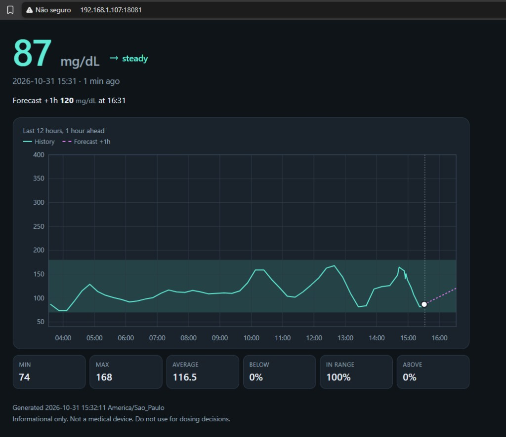

# Glucose dashboard

A small single-user service that stores CGM readings and shows the last 12 hours on one page. Integrations live in separate workers and push data over HTTP. The page is informational. It is not a medical device and it does not recommend doses.

The chart is drawn on the server as inline SVG. The page reloads every 30 seconds to show new readings.



## Run locally

Go 1.26 or newer:

```bash
cp .env.example .env
# edit API_KEY and, if needed, LISTEN_ADDR
go run ./cmd/server
```

The server loads `.env` from the working directory. A variable that is already set in the environment is left as it is. A missing `.env` file is ignored.

Open the listen address from `LISTEN_ADDR` (default `http://127.0.0.1:8080/`). `API_KEY` is required. When `DASH_PASSWORD` is set, the page asks for HTTP Basic authentication. The username can be anything; the password is `DASH_PASSWORD`.

`GET /healthz` returns `ok` and is not authenticated.

## Run with Docker Compose

```bash
cp .env.example .env
# edit API_KEY
docker compose up --build
```

The database is stored in the `glucose-data` volume at `/data/glucose.db`. The image runs as a non-root user and the health check calls `/healthz`.

Stop with Ctrl-C. The server shuts down on SIGINT and SIGTERM.

## Test with fake readings

In another terminal, with the server already running:

```bash
export SERVER_URL=http://127.0.0.1:8080
export API_KEY=change-me
./workers/example-curl/push.sh
```

That posts one reading per minute for the last 12 hours. Refresh the dashboard. `HOURS=6` shortens the curve. Details are in [workers/example-curl/README.md](workers/example-curl/README.md).

## LibreLinkUp worker

`workers/librelinkup` is a Node program using `@diakem/libre-link-up-api-client` 0.7.2. It calls `readRaw()` and posts `ValueInMgPerDl`, because the library's `read()` helper uses the account's display unit.

LibreLinkUp's API is unofficial and can change. The client signs in, follows a regional redirect, and refreshes the session when a call fails. History from this client is the sharing-service graph, about 12 hours, plus the current measurement. Started from `workers/librelinkup`, it loads `.env` from that directory the same way the server does. See [workers/librelinkup/README.md](workers/librelinkup/README.md).

```bash
# .env also needs LLU_EMAIL and LLU_PASSWORD
docker compose --profile worker up --build
```

Without the `worker` profile, Compose starts only the dashboard.

## Add a worker

Workers are separate programs. They only need [docs/INGEST.md](docs/INGEST.md):

- `POST /api/v1/readings` with `Authorization: Bearer <API_KEY>`
- resend overlapping minutes; the store keeps one row per minute and the last write wins
- backfill on startup, then poll (default every 60 seconds)
- back off on network errors and stay up after a failed cycle
- do not log the API key or passwords

Put the program in `workers/<name>/` with its own README and `.env.example`. [workers/README.md](workers/README.md) has the checklist.

## Configuration

| Variable | Default | Meaning |
| --- | --- | --- |
| `LISTEN_ADDR` | `:8080` | HTTP listen address |
| `DB_PATH` | `./data/glucose.db` | SQLite file |
| `API_KEY` | required | Bearer token for `/api/*` |
| `DASH_PASSWORD` | unset | When set, protects `GET /` with Basic auth |
| `DISPLAY_TZ` | `America/Sao_Paulo` | IANA timezone for labels |
| `TARGET_LOW` | `70` | Lower edge of the shaded band, mg/dL |
| `TARGET_HIGH` | `180` | Upper edge of the shaded band, mg/dL |

Readings are stored in UTC. The timezone is used only for display.

## Tests

```bash
go test ./...
```

## Design notes

- SQLite uses the pure-Go `modernc.org/sqlite` driver, WAL mode, a 5 second busy timeout, and a single open connection.
- A minute is the primary key. Posting the same minute again overwrites it, so workers can resend history.
- Invalid readings in a batch are listed in `rejected` and do not drop the valid ones. More than 2000 readings, or a body over 1 MB, rejects the whole request.
- The chart window is the constant `chartWindow` (12 hours) in `internal/web`, drawn through one hour ahead. A falling forecast stops at the low target when it would cross it inside that hour, and the caption also gives the time a slope passes the high target inside that hour. Every reading in the window is joined by one line. A single reading is a dot. The vertical axis is 40–400 mg/dL unless a point falls outside, in which case the edge moves out to a multiple of 50.
- Time in range counts stored minutes in the window. Missing minutes are left out of the percentage.
- `store.List` returns plain readings. A future `internal/forecast` package can call it without changing the API or the page.
- There is no retention job. `GET /api/v1/readings` can return at most 7 days per request. Older rows stay in the database.
